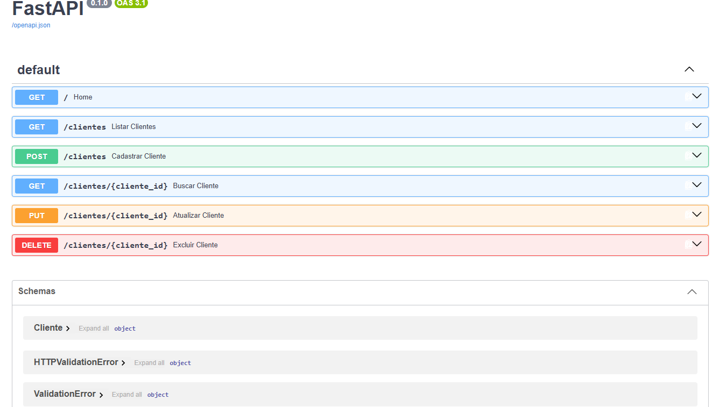

# Customer Management API

[](https://github.com/morettichaves/customer-management-api/actions/workflows/quality.yml)

API REST para gerenciamento de clientes construída com **Python, FastAPI e MySQL**.

O projeto demonstra operações CRUD, integração com banco de dados, validação de entrada, tratamento de erros, testes automatizados e integração contínua.

## Contexto e decisões

Este é um projeto de estudo de Back-End: centralizar um cadastro de clientes e oferecer operações consistentes para criar, consultar, atualizar e excluir registros.

- **Solução:** API REST com FastAPI e persistência em MySQL.
- **Validação:** Pydantic normaliza espaços nas extremidades do nome, limita tamanho dos campos e faixa de idade; `EmailStr` valida o formato do e-mail, que é convertido para minúsculas.
- **Acesso a dados:** consultas SQL parametrizadas, com aquisição e liberação centralizadas de cursor e conexão, incluindo caminhos de falha.
- **Comportamento HTTP:** criação retorna 201, registros inexistentes retornam 404 e entradas inválidas retornam 422.
- **Qualidade:** testes do contrato HTTP e integração contínua com lint e cobertura mínima exigida de 80%.

O repositório apresenta uma API de estudo, não um sistema já validado para uso com dados reais de clientes. Veja os limites atuais e a revisão técnica abaixo.

## Demonstração

A documentação interativa é gerada automaticamente pelo FastAPI com Swagger UI.



## Funcionalidades

- Criar, listar, consultar, atualizar e excluir clientes
- Persistência de dados com MySQL
- Normalização de nome, validação do formato de e-mail e limites de idade com Pydantic
- Credenciais protegidas por variáveis de ambiente
- Consultas SQL parametrizadas
- Respostas HTTP 404 e 422 para erros conhecidos
- Testes automatizados com cobertura mínima de 80%
- Lint e testes executados no GitHub Actions

### Regras de entrada

- O nome é normalizado removendo espaços das extremidades e deve ter entre 2 e 100 caracteres depois disso. Nomes vazios ou compostos apenas de espaços são rejeitados.
- O e-mail usa `EmailStr` do Pydantic com `email-validator`, possui limite de 150 caracteres e é armazenado em minúsculas. A validação é de formato, não confirma a existência ou a propriedade da caixa de e-mail.
- A idade deve estar entre 0 e 130.
- Entradas inválidas retornam HTTP 422 antes de acessar o banco, tanto na criação quanto na atualização.

`email-validator` é instalado junto com as dependências de `requirements.txt`. Referência: [EmailStr na documentação do Pydantic](https://docs.pydantic.dev/latest/api/networks/#pydantic.networks.EmailStr).

## Tecnologias

- Python 3.12
- FastAPI
- MySQL Connector/Python
- Pydantic
- Pytest e pytest-cov
- Ruff
- GitHub Actions

## Endpoints

| Método | Endpoint | Descrição |
|---|---|---|
| GET | `/` | Verifica o estado da API |
| GET | `/clientes` | Lista todos os clientes |
| GET | `/clientes/{cliente_id}` | Busca um cliente |
| POST | `/clientes` | Cria um cliente |
| PUT | `/clientes/{cliente_id}` | Atualiza um cliente |
| DELETE | `/clientes/{cliente_id}` | Exclui um cliente |

## Instalação

```bash
git clone https://github.com/morettichaves/customer-management-api.git
cd customer-management-api
python -m venv .venv
```

No Windows PowerShell:

```powershell
.\.venv\Scripts\Activate.ps1
pip install -r requirements.txt
```

## Banco de dados

```sql
CREATE DATABASE customer_management;
USE customer_management;

CREATE TABLE clientes (
    id INT AUTO_INCREMENT PRIMARY KEY,
    nome VARCHAR(100) NOT NULL,
    email VARCHAR(150) NOT NULL,
    idade INT NOT NULL
);
```

Crie um arquivo `.env` na raiz:

Você pode copiar o exemplo sem credenciais reais:

```powershell
Copy-Item .env.example .env
```

Depois ajuste os valores para o seu MySQL local:

```env
DB_HOST=localhost
DB_USER=root
DB_PASSWORD=sua_senha
DB_NAME=customer_management
```

O arquivo `.env` está protegido pelo `.gitignore` e não deve ser enviado ao GitHub.

## Executando a API

```bash
uvicorn app:app --reload
```

- API: `http://127.0.0.1:8000`
- Swagger: `http://127.0.0.1:8000/docs`

## Qualidade e testes

Instale as dependências de desenvolvimento:

```bash
pip install -r requirements-dev.txt
```

Execute:

```bash
ruff check .
pytest
```

Cada Pull Request executa automaticamente lint, testes e geração do relatório de cobertura.

Os testes unit?rios substituem o banco por `FakeConnection` e `FakeCursor`. Eles verificam respostas, comandos SQL e fechamento de recursos nos caminhos cobertos, sem criar clientes em um MySQL real. A cobertura alta não substitui um teste de integração com banco.

## Exemplo de uso

Com MySQL configurado, tabela criada e servidor iniciado, envie no Swagger (`/docs`) um `POST /clientes` com:

```json
{
  "nome": "Ana Lima",
  "email": "ana@example.com",
  "idade": 28
}
```

Uma criação bem-sucedida retorna HTTP 201 e o ID gerado pelo banco. Use esse ID em `GET /clientes/{cliente_id}`, `PUT /clientes/{cliente_id}` e `DELETE /clientes/{cliente_id}`. Execute esses exemplos em um banco de teste.

## Limites atuais e próximos passos

### Falhas do MySQL

Erros operacionais ou de comunicação do conector retornam HTTP 503 com uma mensagem genérica de indisponibilidade. Outros erros MySQL retornam HTTP 500, sem expor consultas, credenciais ou mensagens internas. Respostas 404 e 422 continuam com seu comportamento anterior.

Nas falhas de escrita, a aplicação tenta rollback. Cursor e conexão têm fechamento tentado independentemente; erros MySQL no rollback ou na limpeza são registrados sem substituir a resposta da operação. Uma falha de limpeza após um commit concluído não converte o sucesso em erro.

Não há repetição automática de escritas. Se a conexão cair durante um commit, o resultado pode ser incerto mesmo com tentativa de rollback; confira o cadastro antes de reenviar a operação. Os testes simulam essas falhas, sem acessar um banco comercial.

- Não há autenticação ou autorização; as operações de cadastro não devem ser expostas com dados reais sem controle de acesso.
- A listagem retorna todos os clientes, sem paginação.
- A rota `/` verifica apenas que a aplicação responde, não a disponibilidade do MySQL.

Prioridade sugerida: testar a integração MySQL; depois evoluir paginação e controle de acesso. O registro da revisão e das correções está em [docs/REVISAO-TECNICA.md](docs/REVISAO-TECNICA.md).

## Estrutura

```text
customer-management-api/
├── .github/workflows/quality.yml
├── screenshots/
├── docs/REVISAO-TECNICA.md
├── tests/
│   └── test_app.py
├── AGENTS.md
├── .env.example
├── app.py
├── pyproject.toml
├── requirements.txt
├── requirements-dev.txt
└── README.md
```

## Autor

**Otávio Moretti** — Desenvolvedor Back-End Júnior

- [GitHub](https://github.com/morettichaves)
- [LinkedIn](https://www.linkedin.com/in/otavio-moretti)

## Integração com MySQL isolado

O GitHub Actions inicia um MySQL 8.4 temporário e executa os testes unitários e de integração. Os testes de integração validam o ciclo de cadastro, consulta, listagem, atualização e exclusão, incluindo normalização dos dados, atualização sem mudanças, respostas 404 e rejeição de entradas inválidas.

O serviço usa exclusivamente o banco `customer_api_test`, usuário `integration` e host local do runner. A senha definida no workflow é descartável, exclusiva desse serviço de teste. Não são utilizados os dados de conexão do `.env` nem bancos de projetos publicados.

Sem `MYSQL_INTEGRATION=1`, os testes de integração são ignorados e `pytest` executa os testes unitários normalmente. Não habilite a integração em um MySQL compartilhado: o teste recria e remove a tabela `clientes` no banco de teste. O serviço e os dados são descartados ao terminar o job.
